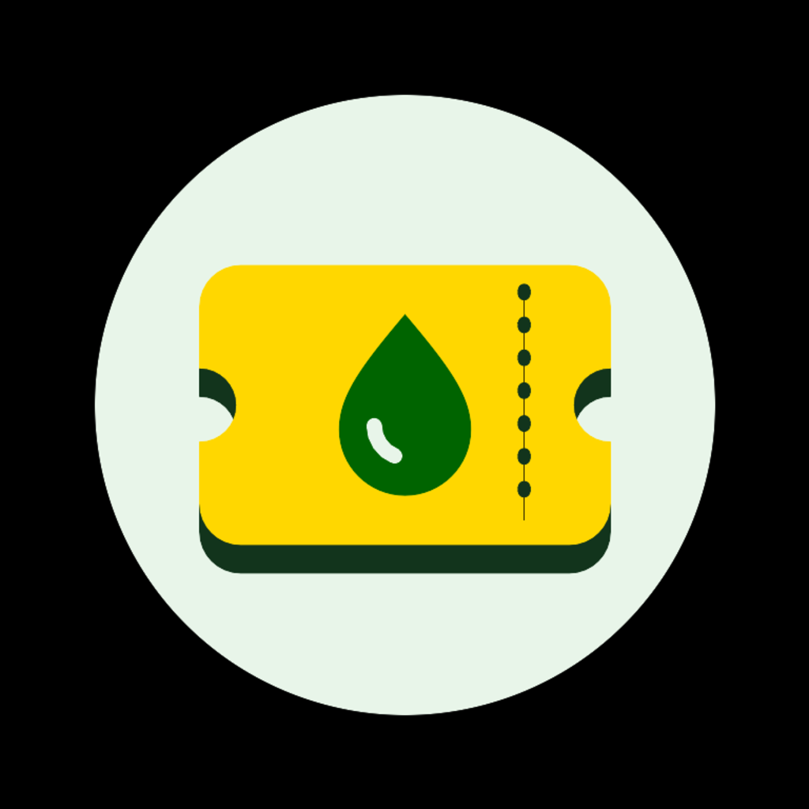
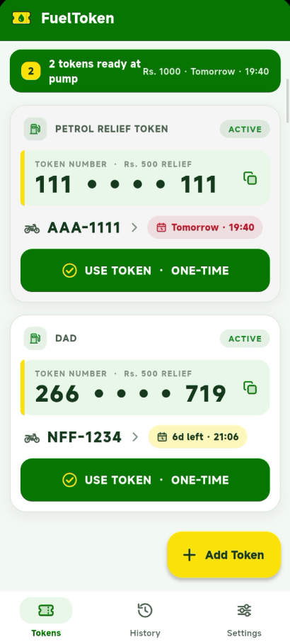
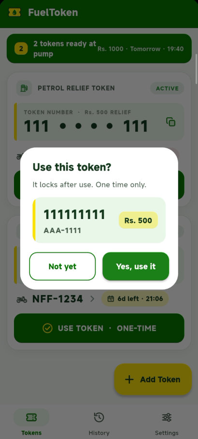
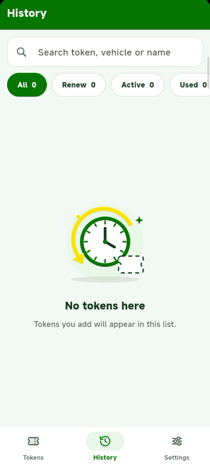

  

  # FuelToken Tracker ⛽
  
  **An offline-first, high-privacy Android app to track, manage, and redeem Pakistan 9771 petrol subsidy relief tokens.**

  

   

  
  
  

---

## 📥 Direct APK Download

No need to compile or set up Flutter. Download the ready-to-install Android APK directly to your phone:

👉 **[Download FuelToken-Tracker-v0.3.0.apk (Direct Download)](https://github.com/abduljawad-ai/Petrol-Subsidy-Token-Tracker/releases/latest/download/FuelToken-Tracker-v0.3.0.apk)**

*(Or browse all versions on the [Releases Page](https://github.com/abduljawad-ai/Petrol-Subsidy-Token-Tracker/releases))*

---

## 🌟 Highlights & Features

- 🔒 **Zero-Leak Privacy**: Token codes are masked (`266 •••• 719`) in public lists to prevent shoulder-surfing. Codes are only revealed when specifically opened or actively redeemed at the pump.
- ⚡ **AI-Powered OCR Scanner**: Scan paper receipts or screenshot SMS directly with Google Gemini AI. Free and fast (no credit card needed).
- 📲 **1-Tap WhatsApp & SMS Import**: Intelligent parser extracts vehicle registration plates, subsidy values, and expiry dates from raw 9771 text formats.
- ⏳ **Smart Expiry & Renewal Reminders**: Countdown timers track deadlines. In-app indicators and local offline push notifications notify you the moment a vehicle becomes eligible for its next weekly subsidy token.
- ☁️ **Private Google Drive Sync**: Backup your tokens seamlessly to your personal Google Drive app-private folder (`appDataFolder`). Zero third-party databases, encrypted snapshot merges, and completely offline-tolerant.
- 🎨 **Purpose-Built Native UI**: Designed with high-contrast accessibility tailored for bright daylight at petrol pumps with one-handed usability.

---

## 📱 Screenshots

| 1. Active Tokens (Privacy Masked) | 2. One-Time Redeem Modal | 3. Complete History & Search |
|:---:|:---:|:---:|
|  |  |  |
| Compact header & protected codes | Attendant-friendly verification & one-time lock | Multi-select delete, filter & renewal tracking |

---

## 📄 License

This project is open-source under the [MIT License](LICENSE).

---

  Crafted with care by <a href="https://github.com/abduljawad-ai"><b>Jawad</b></a>

