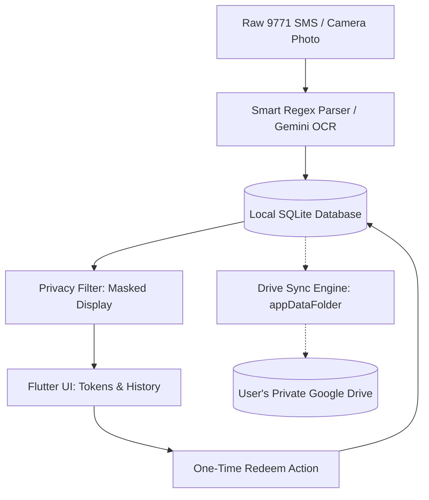

<div align="center">

  

  # FuelToken Tracker ⛽
  
  **An offline-first, high-privacy Android utility to track, manage, and redeem Pakistan 9771 petrol subsidy relief tokens.**

  [](https://flutter.dev)
  [](https://dart.dev)
  [](https://android.com)
  [](https://sqlite.org)
  [](https://github.com/abduljawad-ai)
  [](LICENSE)

</div>

---

## 🌟 Highlights & Features

- 🔒 **Zero-Leak Privacy**: Token codes are masked (`266 •••• 719`) in public lists to prevent shoulder-surfing. Codes are only revealed when specifically opened or actively redeemed at the pump.
- ⚡ **AI-Powered OCR Scanner**: Scan paper receipts or screenshot SMS directly with Google Gemini AI. Free and fast (no credit card needed).
- 📲 **1-Tap WhatsApp & SMS Import**: Intelligent parser extracts vehicle registration plates, subsidy values, and expiry dates from raw 9771 text formats.
- ⏳ **Smart Expiry & Renewal Reminders**: Countdown timers track deadlines. In-app indicators and local offline push notifications notify you the moment a vehicle becomes eligible for its next weekly subsidy token.
- ☁️ **Private Google Drive Sync**: Backup your tokens seamlessly to your personal Google Drive app-private folder (`appDataFolder`). Zero third-party databases, encrypted snapshot merges, and completely offline-tolerant.
- 🎨 **Purpose-Built Native UI**: Designed with high-contrast accessibility tailored for bright daylight at petrol pumps with one-handed usability.

---

## 📱 Screenshots & Visual Flow

| 1. Active Tokens (Privacy Masked) | 2. Redesigned Settings & Gemini Setup | 3. Token Detail View |
|:---:|:---:|:---:|
|  |  |  |
| Compact status header & protected codes | Clear step-by-step API guide & Drive sync | Full ticket layout & single-tap redeem |

---

## 🏗️ Architecture & Security Model



### Privacy & Secrets Guarantee
- **No API Keys Hardcoded**: The repository contains zero embedded keys, secrets, or passwords.
- **Client-Side Storage**: Gemini API keys are entered by the user and stored strictly on the local device (`DatabaseHelper`).
- **Private Cloud Data**: Cloud backups reside strictly in the user's personal Google Drive hidden folder, ensuring zero tracking by intermediary servers.

---

## 🚀 Getting Started

### Prerequisites
- [Flutter SDK](https://docs.flutter.dev/get-started/install) (v3.24+ recommended)
- Android SDK (API 24+)
- A physical Android device or emulator

### Installation

1. **Clone the repository:**
   ```bash
   git clone https://github.com/abduljawad-ai/fueltoken-tracker.git
   cd fueltoken-tracker
   ```

2. **Fetch dependencies:**
   ```bash
   flutter pub get
   ```

3. **Run automated tests:**
   ```bash
   flutter test
   ```

4. **Run or build release APK:**
   ```bash
   # Run in debug mode
   flutter run

   # Assemble optimized release APK
   flutter build apk --release --target-platform android-arm64
   ```
   The built APK will be ready at `build/app/outputs/flutter-apk/app-release.apk`.

---

## 🛠️ Tech Stack & Directory Structure

- **Framework**: [Flutter](https://flutter.dev) & [Dart](https://dart.dev)
- **Local Database**: [sqflite](https://pub.dev/packages/sqflite) (SQLite)
- **Cloud Backup**: Google Drive API v3 (REST via `google_sign_in` and app-private folder)
- **OCR Engine**: Google Gemini Flash API (`google_generative_ai` via user-provided key)
- **Notifications**: `flutter_local_notifications` & `timezone`

```
lib/
├── db/          # Database helper & schema migrations
├── models/      # Data structures (TokenRecord, VehicleType, TokenStatus)
├── screens/     # UI Pages (Home, History, Detail, Settings, OCR Scanner)
├── services/    # Drive sync, SMS parser, plate formatting, renewal logic
├── theme/       # App graphics, typography, and styling
└── widgets/     # Specialized ticket cards, empty states, and overlays
```

---

## 📄 License

This project is open-source under the [MIT License](LICENSE).

---

<div align="center">
  Crafted with care by <a href="https://github.com/abduljawad-ai"><b>Jawad</b></a>
</div>
